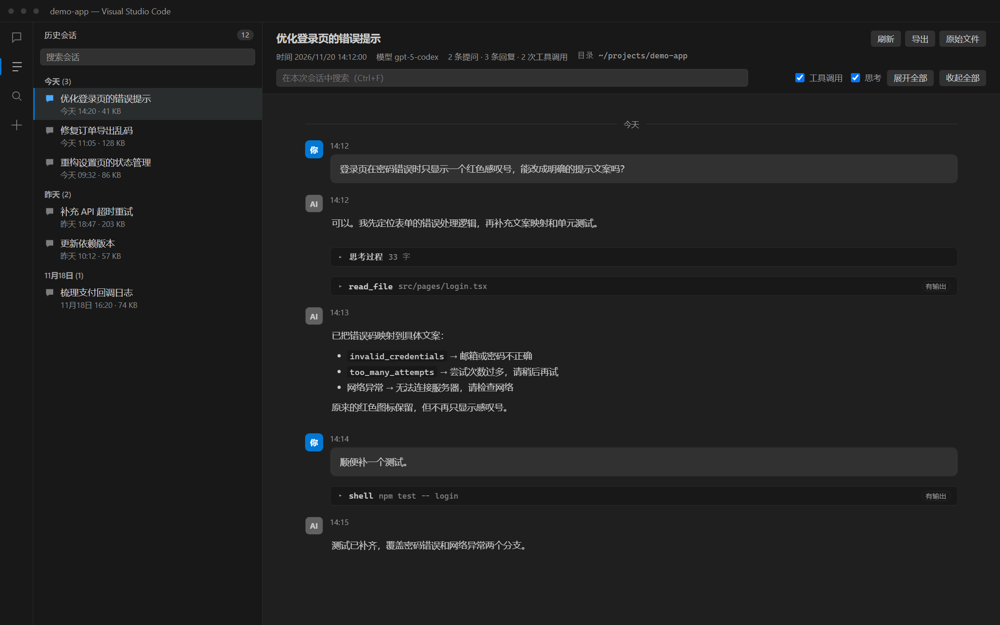
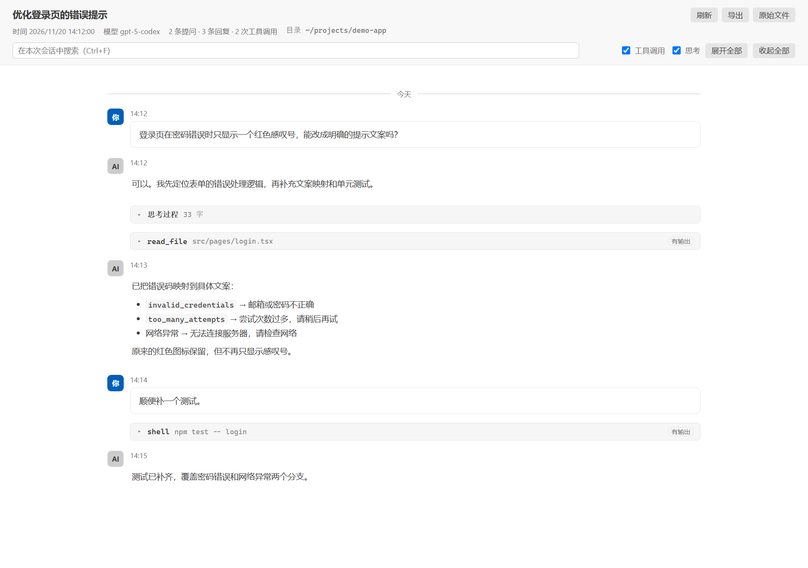

# Codex Chat History for VS Code

English | [简体中文](README.md)

Browse your local Codex sessions inside VS Code and jump back into the original conversation with one click. The extension only reads the rollout files Codex already stores on disk: nothing is modified or uploaded.



## Features

- A sidebar that groups sessions by day (Today, Yesterday, November 18, ...), newest first within each day, using titles from the Codex session index.
- A chat panel that recreates the conversation: user messages, Codex replies, reasoning, tool inputs/outputs, and screenshots.
- Tool calls and reasoning are collapsed by default and can be expanded individually or all at once.
- In-session search (`Ctrl+F`) across messages, tool inputs, and tool outputs.
- Full-text search across every session, with a jump to the matching message.
- Local file links in replies open the file and line directly; `http(s)` links open in your browser.
- Export a session to Markdown or open the raw `.jsonl` file.
- Right-click a session to **Continue in Codex**; archived sessions can be **restored to Codex**, which unarchives and opens them.
- Watches `sessions/**/*.jsonl`, so the list stays current while a session is running.
- Follows the VS Code light/dark theme and has no third-party runtime dependencies.

The same panel in the light theme:



## Install

From a terminal:

```powershell
code --install-extension .\dist\codex-chat-history-1.2.0.vsix
```

Or open the Extensions view in VS Code, click `...` in the top-right corner, choose **Install from VSIX...**, and select `dist\codex-chat-history-1.2.0.vsix`.

After installation, a **Codex 聊天** icon appears in the activity bar. You can also run **Codex: 打开聊天记录** from the Command Palette.

## Restore to Codex

Right-click a session in the sidebar:

- Regular session: **Continue in Codex**. The extension opens `vscode://openai.chatgpt/local/<session-id>`, which takes you straight to that conversation in the Codex sidebar.
- Archived session (enable `codexHistory.showArchived` first): **Restore to Codex**. The extension runs `codex unarchive <session-id>` and then opens the conversation.

The extension locates the `codex` executable in this order: `codexHistory.codexPath` → `PATH` → the binary bundled with the Codex VS Code extension (`bin/**/codex`).

If the session is not in the data directory used by the Codex VS Code extension (default `~/.codex`), the deep link cannot load it. In that case the extension falls back to an integrated terminal running `codex resume <session-id> --all`, so you can still continue the conversation.

## Data and privacy

- Everything is parsed locally. There is no telemetry and no network upload.
- The extension is read-only by default. It only writes when you explicitly choose **Restore to Codex**, which calls `codex unarchive` to change the archive state.
- Every screenshot in this document uses fictional data: `demo-app`, `~/projects/demo-app`, `src/pages/login.tsx`, and the conversation itself are examples. No real account, path, or chat content is shown.
- The screenshots are generated by `node scripts/render-demo.js`, which uses built-in demo data and never reads the `sessions` directory.
- If you share your own screenshots, remember that sessions may contain real paths, code, secrets, or personal information. The extension does not redact them automatically.

## Data source

By default the extension reads `~/.codex`:

- `sessions/**/rollout-*.jsonl`: complete session records
- `session_index.jsonl`: session titles and update times
- `archived_sessions/**`: optional archived sessions

If you set `CODEX_HOME`, or your Codex data lives elsewhere, point the extension at it:

```json
{
  "codexHistory.codexHome": "D:\\path\\to\\.codex"
}
```

## Settings

| Setting | Default | Description |
| --- | --- | --- |
| `codexHistory.codexHome` | empty | Codex data directory; falls back to `CODEX_HOME` or `~/.codex` |
| `codexHistory.codexPath` | empty | Path to the `codex` executable; auto-detected from `PATH` and the Codex extension |
| `codexHistory.maxSessions` | `300` | Maximum number of sessions shown in the sidebar |
| `codexHistory.showArchived` | `false` | Show archived sessions |
| `codexHistory.groupByDate` | `true` | Group sessions by day |
| `codexHistory.showToolCalls` | `true` | Show tool calls in the chat panel |
| `codexHistory.showReasoning` | `true` | Show reasoning when available |
| `codexHistory.expandToolCalls` | `false` | Expand tool calls by default |

## Commands

- `Codex: 打开聊天记录` (Open chat history)
- `Codex: 刷新会话列表` (Refresh sessions)
- `Codex: 筛选会话列表` / `Codex: 清除会话筛选` (Filter / clear filter)
- `Codex: 只看当前工作区的会话` (Current workspace only)
- `Codex: 在全部会话内容中搜索` (Search all session content)
- `Codex: 打开 Codex 数据目录` (Open Codex data directory)
- `Codex: 在 Codex 中继续对话` (Continue in Codex, session context menu)
- `Codex: 还原到 Codex 对话` (Restore to Codex, archived session context menu)

The session context menu also offers Markdown export, opening the raw record, and revealing the file in the OS file manager.

## Known limitations

- Only the `response_item` / `event_msg` structures of Codex rollouts are parsed. If Codex changes the record format, the parser needs an update.
- Reasoning is shown only when a plain-text summary exists in the record. Encrypted reasoning content cannot be decrypted and is therefore omitted.
- Inline images in user messages are shown only when `input_image` data is present; older records may contain text only.
- Full-text search streams every session file, so the first search over a large history can take a few seconds.
- Restoring relies on the Codex VS Code extension's `/local/<session-id>` route. This is an internal, undocumented route and may change between Codex releases. If it does, the extension falls back to `codex resume` in a terminal.
- The Codex extension only loads sessions under `~/.codex` by default. Sessions in a different `CODEX_HOME` can be resumed in a terminal but will not appear in the extension sidebar.

## Development

```powershell
cd codex-chat-history
npm test
npm run build:vsix
```

`npm test` runs a smoke test against real local sessions. The packaging script has no dependencies and writes the VSIX directly.

Regenerate the README screenshots (requires Edge or Chrome):

```powershell
node scripts/render-demo.js
```

To preview the renderer with a real session, run `node scripts/preview.js`. It reads local sessions and produces a page containing real content, so do not publish that output.

The VSIX is written to `dist\` by default; pass another directory with `node scripts/build-vsix.js <output-dir>`.

## Project layout

```
extension.js          activation, commands, file watchers
src/parser.js         rollout JSONL parser
src/store.js          session index, cache, full-text search
src/tree.js           sidebar tree
src/panel.js          webview chat panel
src/exporter.js       Markdown export and local link handling
src/codexCli.js       codex discovery, unarchive, deep link, terminal resume
src/markdownExport.js export formatting
media/                panel styles, Markdown renderer, interaction script
docs/images/          README screenshots (fictional data)
test/                 parser, renderer, and command tests
scripts/build-vsix.js dependency-free VSIX builder
scripts/render-demo.js demo-data screenshot generator
```

## License

MIT
