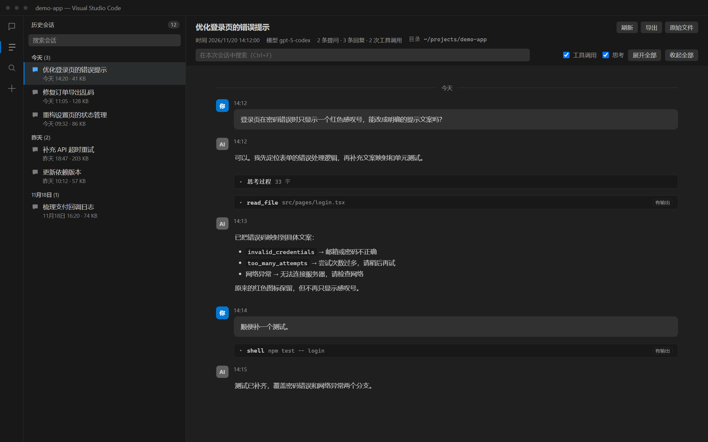
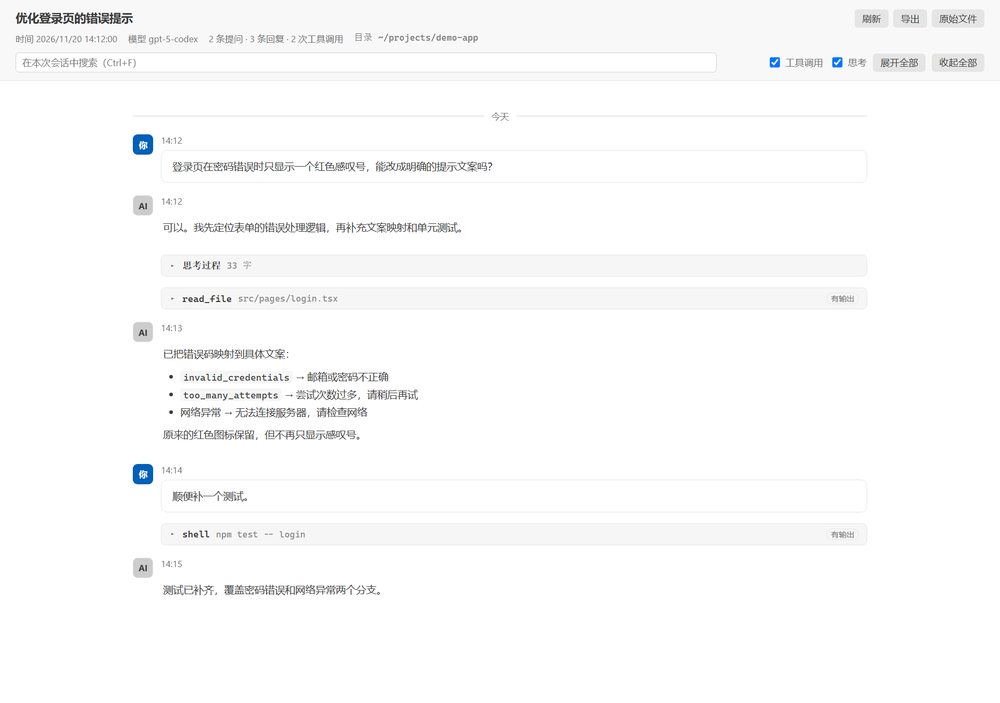

# Codex History Lens（Codex 聊天记录）

官网: [https://suboy1219.github.io/suboy](https://suboy1219.github.io/suboy)

[English](README.en.md) | 简体中文

已发布到 [VS Code 扩展商店](https://marketplace.visualstudio.com/items?itemName=hkle.codex-history-lens-hkle)，点击链接即可安装。

在 VS Code 里直接翻阅本机 Codex 的历史会话，并一键回到 Codex 继续对话；支持保存和切换多个 ChatGPT 账号。历史记录在本地读取，不上传会话数据。

> 这是一个社区扩展，与 OpenAI 无隶属关系。



## 功能

- 侧栏按天分组列出 Codex 会话（今天、昨天、11月18日…），组内按时间倒序；标题取自 Codex 的会话索引。
- 聊天面板按气泡还原对话：你的消息、Codex 回复、思考过程、工具调用输入/输出、用户截图。
- 工具调用与思考过程默认折叠，可单条展开，也可一键展开/收起全部。
- 面板内搜索（`Ctrl+F`），支持过滤消息、工具输入和输出。
- 跨会话全文搜索：命中后直接跳到对应消息。
- 点击回复里的本地文件链接可直接打开对应文件与行号；`http(s)` 链接用系统浏览器打开。
- 一键导出为 Markdown，或打开原始 `.jsonl` 记录。
- 右键会话选择“关注”，标题和星标变为金黄色；可随时取消关注，重启后仍保留关注状态。
- 会话右键可**在 Codex 中继续对话**；已归档会话可**还原到 Codex 对话**，自动取消归档并打开。
- 监听 `sessions/**/*.jsonl`，会话进行中也能刷新/自动更新。
- 跟随 VS Code 明暗主题，除 VS Code 本身外无第三方依赖。

浅色主题下的聊天面板：



## 安装

### 从 VS Code 扩展商店安装

打开 [Codex History Lens 商店页面](https://marketplace.visualstudio.com/items?itemName=hkle.codex-history-lens-hkle)，点击 **Install**；也可以在终端执行：

```powershell
code --install-extension hkle.codex-history-lens-hkle
```

### 从 VSIX 安装

方式一：在 VSIX 所在目录执行命令行安装。

```powershell
code --install-extension .\dist\codex-history-lens-hkle-1.3.2.vsix
```

方式二：VS Code 里打开「扩展」视图，点右上角 `...` → **从 VSIX 安装…**，选择 `dist\codex-history-lens-hkle-1.3.2.vsix`。

安装后左侧活动栏会出现 **Codex 聊天** 图标；也可以按 `Ctrl+Shift+P` 执行 **Codex: 打开聊天记录**。

## 多账号切换

1. 在官方 Codex 中登录第一个 ChatGPT 账号。
2. 点击右下角 **Codex 账号状态栏**，选择 **保存当前登录账号**，取名如“个人账号”。也可使用历史侧栏顶部的账号图标或命令面板。
3. 选择 **添加账号（官方网页登录）**，取名如“工作账号”，在浏览器中切换到第二个 ChatGPT 账号完成登录。该流程使用临时目录，不覆盖当前登录；可取消，5 分钟超时后自动清理。
4. 点击状态栏选择目标账号，结束正在运行的 Codex 任务后确认切换，再点 **重载窗口**。共享该登录目录的其他 Codex CLI / IDE 窗口也需重启。

账号备份使用 VS Code `SecretStorage` 加密保存，不写入设置，也不参与设置同步。切换会更新目标目录的 `auth.json`，并先保存当前登录的最新凭据；未知账号也会自动备份。移除备份不会退出当前登录。重复保存同一个 ChatGPT 身份和工作区会更新原有备份。

仅支持 ChatGPT 网页登录和文件缓存模式（`cli_auth_credentials_store = "file"`）。显式配置为 `keyring` / `auto` / `ephemeral` 或 API key 登录时不执行切换；不会自动更改认证配置。认证受组织策略限制时，请遵循组织要求。参见[官方认证文档](https://developers.openai.com/codex/auth/)。

默认操作 `CODEX_HOME` 或 `~/.codex`。如官方 Codex 使用其他目录，设置 `codexHistory.accountHome`；它与仅用于浏览历史的 `codexHistory.codexHome` 独立。状态栏反映磁盘登录缓存，切换生效依赖窗口重载，不能保证运行中的任务或对话无缝继续。长期未使用的账号凭据可能过期，重新网页登录并保存即可。

## 还原到 Codex

在侧栏的会话条目上点右键：

- 普通会话：**在 Codex 中继续对话**。插件通过 `vscode://openai.chatgpt/local/<会话ID>` 直接打开 Codex 侧栏里的对应会话。
- 已归档会话（需先开启 `codexHistory.showArchived`）：**还原到 Codex 对话**。插件先执行 `codex unarchive <会话ID>`，再打开该对话。

还原需要能定位 `codex` 可执行文件。查找顺序为：`codexHistory.codexPath` → PATH → Codex VS Code 扩展自带的 `bin/**/codex`。

如果会话不在 Codex VS Code 扩展使用的数据目录（默认 `~/.codex`）中，深链无法加载该会话，插件会改为在集成终端执行 `codex resume <会话ID> --all`，仍然可以继续原来的对话。

## 帮助与更新

点击历史会话侧栏工具栏的 **帮助（问号）**，可打开 **使用说明、检测更新、访问官网、关于 Codex History Lens**；也可以在命令面板中搜索对应的 **Codex** 命令。

检测更新仅在主动点击时联网，对比当前版本与本项目 GitHub 最新正式发布版；发现新版后可选择打开发布页下载 VSIX。无正式发布版、网络失败或请求受限时会显示提示。通过商店安装的扩展也可使用 VS Code 自带的扩展更新功能。

## 数据与隐私

- 会话解析在本地完成，无遥测、不上传会话。只有主动点击检测更新时才向 GitHub 发起 HTTPS 请求，User-Agent 中包含扩展版本，不携带聊天数据；不会后台自动检测。
- 浏览历史不修改会话文件。主动还原会话会调用 `codex unarchive`；保存/移除账号会修改加密备份，切换账号会更新 `auth.json`。添加账号通过官方 Codex CLI 连接 OpenAI 完成网页登录。
- 本文档中的截图全部使用虚构会话：`demo-app`、`~/projects/demo-app`、`src/pages/login.tsx` 等均为示例，不包含任何真实账号、路径或聊天内容。
- 截图由 `node scripts/render-demo.js` 生成，该脚本使用内置的演示数据，不会读取 `sessions` 目录。
- 如果你要分享自己的截图，请注意会话里可能包含真实路径、代码、密钥或个人信息；插件本身不做自动脱敏。

## 数据来源

默认读取 `~/.codex`（Windows 为 `C:\Users\<你>\.codex`）：

- `sessions/**/rollout-*.jsonl`：完整会话记录
- `session_index.jsonl`：会话标题与更新时间
- `archived_sessions/**`：可选的已归档会话

如果设置了环境变量 `CODEX_HOME`，或 Codex 数据在别处，请在设置里修改：

```json
{
  "codexHistory.codexHome": "D:\\path\\to\\.codex"
}
```

## 设置

| 设置 | 默认值 | 说明 |
| --- | --- | --- |
| `codexHistory.codexHome` | 空 | Codex 数据目录，留空时用 `CODEX_HOME` 或 `~/.codex` |
| `codexHistory.codexPath` | 空 | `codex` 可执行文件路径，留空时自动查找 PATH 与 Codex 扩展自带版本 |
| `codexHistory.maxSessions` | `300` | 侧栏最多显示的会话数 |
| `codexHistory.showArchived` | `false` | 是否显示已归档会话 |
| `codexHistory.groupByDate` | `true` | 是否按天分组 |
| `codexHistory.showToolCalls` | `true` | 是否显示工具调用 |
| `codexHistory.showReasoning` | `true` | 是否显示思考过程 |
| `codexHistory.expandToolCalls` | `false` | 是否默认展开工具调用 |

## 命令

- `Codex: 打开聊天记录`
- `Codex: 刷新会话列表`
- `Codex: 筛选会话列表` / `Codex: 清除会话筛选`
- `Codex: 只看当前工作区的会话`
- `Codex: 在全部会话内容中搜索`
- `Codex: 打开 Codex 数据目录`
- `Codex: 在 Codex 中继续对话`（会话右键）
- `Codex: 还原到 Codex 对话`（已归档会话右键）

会话条目的右键菜单还可以导出 Markdown、打开原始记录、在文件资源管理器中显示。

## 已知限制

- 只解析 Codex rollout 的 `response_item` / `event_msg` 结构；如果未来 Codex 改了记录格式，插件需要同步适配。
- 思考过程只有在记录里存在明文摘要时才会显示。Codex 常见的加密 reasoning 内容无法解密，因此不会显示。
- 用户消息中内嵌的图片只在有 `input_image` 数据时显示；历史版本可能只记录文本。
- 全文搜索会流式读取全部会话文件，会话很多时第一次搜索会有几秒耗时。
- 「还原」依赖 Codex VS Code 扩展的 `/local/<会话ID>` 深链。该路由是扩展内部的未公开接口，Codex 升级后格式可能变化；变化时插件会回退到 `codex resume` 终端方式。
- Codex 扩展默认只加载 `~/.codex` 下的会话。若插件配置了其他 `CODEX_HOME`，那些会话只能在终端里 `resume`，不会出现在扩展侧栏。

## 开发与打包

```powershell
cd codex-chat-history
npm test
npm run build:vsix
```

`npm test` 会用真实的本机会话做冒烟校验；打包脚本零依赖，直接生成 VSIX。

生成 README 效果图（需要 Edge 或 Chrome）：

```powershell
node scripts/render-demo.js
```

想在开发时快速看真实会话的渲染效果，可执行 `node scripts/preview.js`；它会读取本机会话，生成的预览页包含真实内容，请勿直接公开。

打包结果默认写入项目内的 `dist\`，也可以通过 `node scripts/build-vsix.js <输出目录>` 指定其他位置。

## 项目结构

```
extension.js          激活入口、命令、文件监听
src/parser.js         rollout JSONL 解析
src/store.js          会话索引、缓存、全文搜索
src/tree.js           侧栏树
src/panel.js          Webview 聊天面板
src/exporter.js       Markdown 导出与本地链接跳转
src/codexCli.js       定位 codex、取消归档、深链与终端恢复命令
src/markdownExport.js 导出格式
media/                面板样式、Markdown 渲染、交互脚本
docs/images/          README 效果图（虚构数据）
test/                 解析、渲染与命令测试
scripts/build-vsix.js 零依赖 VSIX 打包
scripts/render-demo.js 用虚构数据生成效果图
```

## License

MIT
